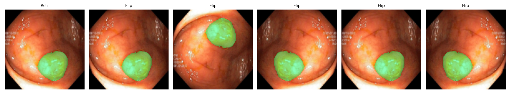
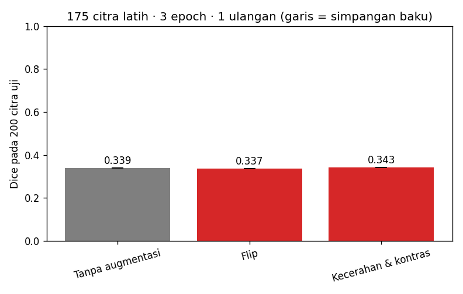
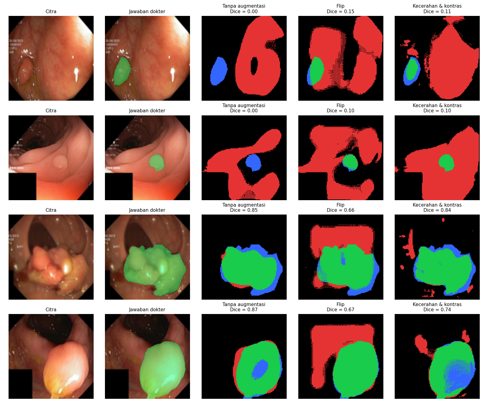

# Segmentasi Polip pada Citra Kolonoskopi dengan U-Net

<!--
  TEMPLATE LAPORAN — Tugas P10 Kecerdasan Buatan (BM25-41204), Teknik Biomedis ITERA.
  Petunjuk lengkap: https://mctm.web.id/ai-bm/tugas

  Cara memakai:
  - Ganti semua teks yang diawali "✍️" dengan tulisan kelompokmu, lalu hapus tanda ✍️-nya.
  - Blok komentar seperti ini adalah petunjuk; tidak tampil di GitHub. Boleh dihapus.
  - Gambar diambil dari folder hasil/ yang dibuat otomatis oleh notebook.
  - Jangan hapus judul-judul bagian (##).
-->

**Tugas P10 — Kecerdasan Buatan (BM25-41204), Teknik Biomedis ITERA**

## Anggota kelompok

| Nama | NIM | Username GitHub | Kontribusi utama |
|---|---|---|---|
| Muhamad Fariz Ar Raniri | 123430110 | arfariz727 | Ketua tim, pelaksanaan eksperimen, dan perancangan augmentasi |
| Claudya Ronauli Lumbantoruan | 123430101 | ronauliclaudya23 | Penyusunan laporan dan dokumentasi hasil eksperimen |
| Annisa Fauziyyah | 123430008 | annisafauziyah11 | Analisis hasil segmentasi dan penyusunan pembahasan |

## 1. Pertanyaan

Augmentasi apa yang membantu U-Net menemukan polip pada citra kolonoskopi, dan augmentasi apa yang tidak? Kenapa?
Augmentasi geomteris seperti flip, rotasi, dan affine serta perubahan pencahayaan seperti brightness dan contrast diperkirakan membantu U-Net karena meniru variasi kondisi pemeriksaan kolonoskopi. Sebaliknya, perubahan hue, saturasi berlebihan, blur, dan deformasi elastis yang terlalu kuat berpotensi mengurangi kemampuan model mengenali karakteristik warna, detail, dan bentuk polip.

## 2. Data & pengaturan

<!-- Isi dari Bagian 2 notebook. Pastikan CEPAT = False untuk hasil akhir. -->

- Dataset: Kvasir-SEG (1000 citra kolonoskopi + mask polip), diperkecil ke 256 × 256 piksel.
- Data uji: 350 citra (tetap). Data latih: 175 citra per ulangan.
- Model: U-Net mini (±0,5 juta parameter), 40 epoch, 5 ulangan per skenario.
- Dijalankan di: Google Colab T4.


## 3. Skenario augmentasi & hipotesis

<!-- Tulis bagian ini SEBELUM menjalankan eksperimen. Commit dulu, baru jalankan.
     Alasan klinis = kenapa variasi ini mungkin (atau tidak mungkin) terjadi pada kolonoskopi sungguhan. -->

| Skenario | Augmentasi (kode) | Alasan klinis | Hipotesis: Dice naik/turun/sama? |
|---|---|---|---|
| Tanpa augmentasi | — | Digunakan sebagai pembanding untuk mengetahui kemampuan dasar U-Net tanpa variasi citra tambahan. | — |
|Flip |`v2.Compose([v2.RandomHorizontalFlip(), v2.RandomVerticalFlip()])` |Orientasi tampilan polip dapat berubah ketika endoskop diputar atau diarahkan dari sudut pandang yang berbeda. Augmentasi flip digunakan untuk melatih model mengenali polip dengan orientasi yang bervariasi.|Diperkirakan meningkat|
|Kecerahan & kontras|`v2.ColorJitter(brightness=0.3, contrast=0.3)` |Intensitas pencahayaan dan kontras citra dapat berubah akibat perbedaan pencahayaan endoskop, jarak kamera, serta pantulan cahaya pada permukaan mukosa usus.|Diperkirakan meningkat|

Contoh augmentasi yang dicoba:


<!-- Ganti nama file sesuai skenario kalian (lihat isi folder hasil/). -->

## 4. Hasil
|Skenario | Dice (rata-rata ± sb) | IoU (rata-rata ± sb) | Dice tiap ulangan |
|---|---|---|---|
| Tanpa augmentasi | 0.574 ± 0.033 | 0.459 ± 0.027 | 0.613, 0.535, 0.571, 0.609, 0.540 |
| Flip | 0.622 ± 0.029 | 0.506 ± 0.036 | 0.603, 0.649, 0.595, 0.598, 0.664 |
| Kecerahan & kontras | 0.521 ± 0.089 | 0.410 ± 0.076 | 0.571, 0.355, 0.524, 0.538, 0.615|



## 5. Analisis peta kesalahan



<!-- Hijau = benar, merah = false positive, biru = false negative.
     Pertanyaan pemandu: Polip seperti apa yang sering terlewat (kecil? datar? warna mirip dinding usus?)
     Apa yang sering dikira polip padahal bukan? Apakah augmentasi memperbaiki kasus sulit? -->

Berdasarkan peta kesalahan, terlihat bahwa kemampuan model U-Net dalam melakukan segmentasi polip berbeda pada setiap citra. Warna hijau menunjukkan area polip yang berhasil diprediksi dengan benar (true positive), warna merah menunjukkan area yang salah diprediksi sebagai polip (false positive), sedangkan warna biru menunjukkan bagian polip yang tidak berhasil terdeteksi (false negative).

Pada contoh citra pertama, model tanpa augmentasi dan model dengan augmentasi kecerahan serta kontras memperoleh Dice sebesar 0,00. Sementara itu, model dengan augmentasi Flip memperoleh Dice sebesar 0,67. Hal ini menunjukkan bahwa augmentasi Flip membantu model mengenali polip pada citra tersebut. Namun, pada contoh kedua, ketiga skenario masih menunjukkan hasil segmentasi yang kurang baik dengan Dice masing-masing sebesar 0,00; 0,00; dan 0,03.

Pada contoh ketiga, model tanpa augmentasi memperoleh Dice sebesar 0,97, lebih tinggi dibandingkan Flip sebesar 0,74 dan kecerahan serta kontras sebesar 0,92. Hal ini menunjukkan bahwa augmentasi tidak selalu meningkatkan hasil segmentasi. Pada contoh keempat, ketiga skenario memperoleh Dice yang tinggi, yaitu 0,97 untuk tanpa augmentasi, 0,96 untuk Flip, dan 0,98 untuk kecerahan serta kontras.

Secara keseluruhan, peta kesalahan menunjukkan bahwa keberhasilan segmentasi dipengaruhi oleh karakteristik masing-masing citra. Augmentasi Flip dapat membantu pada beberapa citra, tetapi tidak selalu memberikan hasil yang lebih baik. Begitu pula dengan augmentasi kecerahan dan kontras yang belum menunjukkan peningkatan secara konsisten. Hasil ini memperlihatkan bahwa pemilihan teknik augmentasi perlu mempertimbangkan karakteristik visual citra polip agar dapat meningkatkan kemampuan model dalam melakukan segmentasi.

## 6. Pembahasan & kesimpulan

<!-- Bandingkan hasil dengan hipotesis di Bagian 3. Hipotesis yang ternyata salah tetap bernilai,
     asalkan dijelaskan kenapa. Perbedaan kecil (lebih kecil dari simpangan baku) belum tentu berarti. -->

Berdasarkan hasil eksperimen, augmentasi Flip memberikan hasil terbaik dibandingkan skenario tanpa augmentasi maupun augmentasi kecerahan dan kontras. Model dengan augmentasi Flip memperoleh rata-rata Dice sebesar 0,622 ± 0,029 dan IoU sebesar 0,506 ± 0,036. Hasil ini lebih tinggi dibandingkan model tanpa augmentasi yang memperoleh Dice sebesar 0,574 ± 0,033 dan IoU sebesar 0,459 ± 0,027. Dengan demikian, hipotesis awal bahwa augmentasi Flip dapat meningkatkan kemampuan segmentasi polip didukung oleh hasil eksperimen.
Peningkatan tersebut kemungkinan terjadi karena augmentasi Flip memberikan variasi orientasi citra sehingga model dapat mempelajari karakteristik polip dari berbagai posisi. Hal ini membantu U-Net mengenali polip tanpa terlalu bergantung pada orientasi tertentu dalam citra pelatihan. Namun, peningkatan rata-rata tersebut belum dapat dianggap sebagai bukti peningkatan yang signifikan secara statistik karena eksperimen hanya dilakukan sebanyak lima ulangan.

## 7. Pembagian kerja

<!-- Siapa mengerjakan apa. Penilaian proses kerja dilihat dari riwayat commit tiap anggota. -->

✍️

## 8. Penggunaan AI

<!-- Wajib diisi, walau tidak memakai AI (tulis "Tidak memakai AI").
     Contoh: "Claude Code (CLI) untuk menulis skenario augmentasi dan memperbaiki error di Bagian 4.
     Draf Bagian 6 ditulis sendiri, lalu dirapikan bahasanya dengan bantuan AI." -->

Dalam pengerjaan tugas ini, kelompok kami menggunakan ChatGPT sebagai alat bantu selama proses pengerjaan, terutama untuk:

- Membantu memahami kode dan cara kerja U-Net pada proses segmentasi polip.
- Mencari ide dan menentukan skenario augmentasi yang digunakan, yaitu Flip serta Kecerahan dan Kontras.
- Membantu mengatasi beberapa kendala saat menjalankan notebook di Google Colab dan mengelola file di GitHub.
- Membantu merapikan penulisan dan dokumentasi pada README.

Penggunaan AI hanya sebagai pendamping selama pengerjaan. Pemilihan skenario, pelaksanaan eksperimen, pengamatan hasil, serta pembahasan dan kesimpulan tetap dilakukan oleh anggota kelompok.

## Cara menjalankan ulang

```bash
uv sync
uv run jupyter lab segmentasi_polip.ipynb
```

Atau buka notebook di Google Colab (Runtime → Change runtime type → T4 GPU).

## Referensi

- Jha, D., dkk. (2020). Kvasir-SEG: A Segmented Polyp Dataset. *MultiMedia Modeling (MMM 2020)*, 451–462.
- Ronneberger, O., Fischer, P., & Brox, T. (2015). U-Net: Convolutional Networks for Biomedical Image Segmentation. *MICCAI*. arXiv:1505.04597.
- Chen, S., Urban, G., & Baldi, P. (2022). Weakly Supervised Polyp Segmentation in Colonoscopy Images Using Deep Neural Networks. *Journal of Imaging, 8*(5), 121. [DOI](https://doi.org/10.3390/jimaging8050121) | 

- Mohapatra, S., Pati, G. K., Mishra, M., & Swarnkar, T. (2022). UPolySeg: A U-Net-Based Polyp Segmentation Network Using Colonoscopy Images. *Gastroenterology Insights, 13*(3), 264–274. [DOI](https://doi.org/10.3390/gastroent13030027) | 

- Ali, S., et al. (2024). Assessing generalisability of deep learning-based polyp detection and segmentation methods through a computer vision challenge. *Scientific Reports, 14*, 2032. [DOI](https://doi.org/10.1038/s41598-024-52063-x) | 

- Tudela, Y., et al. (2024). A complete benchmark for polyp detection, segmentation and classification in colonoscopy images. *Frontiers in Oncology, 14*, 1417862. [DOI](https://doi.org/10.3389/fonc.2024.1417862) | 

- Mei, J., et al. (2025). A survey on deep learning for polyp segmentation: techniques, challenges and future trends. *Visual Intelligence, 3*, Article 1. [DOI](https://doi.org/10.1007/s44267-024-00071-w) |
